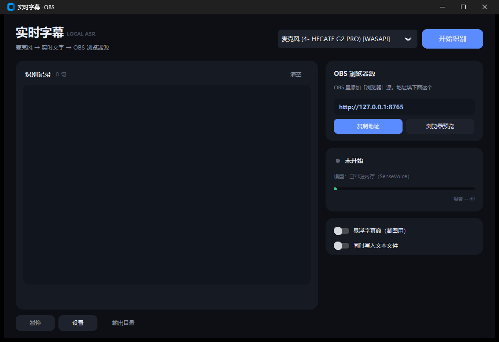

# 实时字幕 · OBS Live Captions

说话的同时把声音变成文字，通过**本地网页**喂给 OBS「浏览器源」。字幕直接叠在游戏画面上，
你自己的屏幕上不用挂任何窗口，不影响玩游戏。

- 内置 SenseVoice 中文专精模型，对南方口音、口语更准，CPU 上约 50 倍速、不占显存
- 也支持 Whisper large-v3（多语言，占用约 3GB 显存），可在设置里切换
- 麦克风实时识别，先出「正在识别」的浅色字幕，停顿后变成正式字幕
- OBS 浏览器源读 `http://127.0.0.1:8765`，网页背景全透明，不需要窗口采集/色键
- 字幕停留时间可调（默认 4 秒），到点自动淡出，不长期占屏
- 内置 RNNoise 降噪 + 噪声门（CPU，和 OBS 的降噪/噪音阈值同理）
- 内置「词曲李宗盛」等常见幻觉过滤，支持自定义屏蔽词
- 内置直播违禁词过滤，命中后替换为 `*`，避免字幕出现不合适内容
- 数字自动转阿拉伯数字（「十号房」→「10号房」），支持中英混排
- 启动即把模型常驻内存/显存，点「开始识别」秒开，不用每次等待加载
- 全程本地识别，不联网、不上传声音



OBS 浏览器源里看到的效果（背景透明，直接叠在游戏画面上）：


---

## 一、安装

### 一键安装（推荐）

双击 **`安装依赖.bat`**，它会自动完成：

1. 检测 Python 3.10+，没有就用 winget 自动安装（装不了会打开官网让你手动装）
2. 安装全部 Python 依赖（清华镜像加速，失败自动切官方源）
3. 可选安装 NVIDIA CUDA 加速库（用 Whisper 引擎时才需要）
4. 可选下载中文模型 SenseVoice（约 230MB，推荐）

### 手动安装

```bash
python -m pip install -r requirements.txt
python -X utf8 model_download.py sensevoice
```

> 只支持 Windows 10/11。macOS/Linux 理论上能跑，需要自己装 PortAudio。

---

## 二、快速开始

1. 双击 **`启动实时字幕.bat`**
2. 启动后状态卡片会显示「模型：已常驻内存（SenseVoice）」，表示模型已就绪，随时可用
3. 顶部选择麦克风（优先选名字后面带 `[WASAPI]` 的，延迟更低）
4. 点右上角 **「开始识别」**，几乎立刻进入聆听状态
5. 说话，文字会出现在「识别记录」里，网页字幕源已在 `http://127.0.0.1:8765` 待命

> SenseVoice 在 CPU 上运行，不占显卡显存，适合边玩游戏边直播。
> 如果切到 Whisper 引擎，模型会常驻显存（约 3GB）；显存吃紧时切回 SenseVoice 或关闭程序。
> 修改识别引擎、模型或推理设备后，程序会自动重新载入。

想先验证整条链路：双击 **`演示-测试字幕.bat`**，会播放一段测试语音，不用你说话。

---

## 三、OBS 设置（浏览器源）

1. OBS「来源」→ **+** → **「浏览器」**
2. **URL** 填 `http://127.0.0.1:8765`
3. 宽度 **1920**、高度 **1080**（与画布一致即可，字幕固定在下方居中）
4. 勾选「关闭源时关闭浏览器」省资源
5. 把浏览器源拖到最上层

> 页面背景本身透明，**不需要**色键、不需要窗口采集。
> 字幕默认停留 4 秒后淡出，可在「设置 → 字幕 → 字幕停留」调整（1.5~12 秒）。
> 端口被占用会自动换一个，程序界面上的 URL 会同步变化。

### 备选：悬浮字幕窗

打开「悬浮字幕窗」开关会出现一个置顶黑底白字窗口，OBS 用「窗口采集」抓它，
再用色度键抠黑底。默认关闭。

---

## 四、口音和方言

- **普通话带口音**（广西、广东、川渝等）：识别引擎用默认的 **SenseVoice**（中文专精），
  它对带口音的普通话和口语比 Whisper 更稳，而且不占显存。说话离麦克风近一点，降噪打开。
- **说粤语**：语言切到「粤语（粤语口音）」，SenseVoice 支持粤语。
- **中英混说、英文多**：可以切到 Whisper 引擎（多语言更强，但更吃硬件）。
- 个别词老是听错：用「纠错规则」兜底，例如 `安逸=暗影`、`丢帧=掉帧`。

---

## 五、设置说明

| 设置 | 说明 | 建议 |
| --- | --- | --- |
| 识别引擎 | SenseVoice（中文专精）/ Whisper（多语言） | 默认 SenseVoice |
| Whisper 模型 | 仅 Whisper 引擎使用 | 默认 `large-v3`，N 卡约 10 倍速 |
| 推理设备 | 自动 / NVIDIA / CPU，仅 Whisper 使用 | 有 N 卡保持「自动」 |
| 语言 | 中文 / 粤语 / English / 自动 | 固定「中文」最稳 |
| 降噪模式 | RNNoise、噪声门、两者组合、关闭 | 默认「RNNoise + 噪声门」 |
| 噪声门阈值 | 低于该音量的声音直接静音 | 默认 -50 dB，见第六节 |
| 静音断句 | 停顿多久算一句话结束 | 默认 800ms，说话快可调 650 |
| 最长一句 | 一句话最多多长就强制切段 | 默认 12 秒 |
| VAD 灵敏度 | 0 最灵敏，3 最抗噪 | 环境吵就调到 3 |
| 热词 | 游戏名、人名，逗号分隔（仅 Whisper 引擎） | 已预置恐鬼症/英雄联盟/异环/硬件词 |
| 纠错规则 | 每行 `错=对`，强制替换 | 如 `安逸=暗影` |
| 数字转阿拉伯数字 | 「十号房」→「10号房」 | 默认开启 |
| 字幕停留 | 一句字幕在屏幕上停留多久 | 默认 4 秒 |
| 每行宽度 / 显示行数 | 字幕折行与显示行数 | 40 / 1 |
| 屏蔽词 | 每行一个，命中整句丢弃 | 已预置常见幻觉词 |
| 违禁词过滤 | 每行一个词，命中后每字变成 `*` | 默认开启，按平台要求增删 |

> 修改「模型 / 推理设备 / 断句 / 降噪」后需要停止再开始识别；外观类设置立即生效。

---

## 六、降噪怎么调

用的是 CPU 降噪，思路和 OBS 一样：

- **RNNoise**：压掉风扇、空调、电流声这类持续底噪（OBS 默认的「噪声抑制」也是它）
- **噪声门**：低于阈值的声音直接静音（相当于 OBS 的「噪音阈值」），挡住键盘、呼吸声

状态卡片实时显示「噪音 -XX dB」：

1. 不说话时看这个数字，比如 `-52 dB`
2. 把噪声门阈值调到比它高 3~6 dB，例如 `-47 dB`
3. 说话时数字明显升高，字幕正常出现；不说话时不再冒乱码

环境特别吵就把 VAD 灵敏度也调到 3；想完全关掉降噪，把降噪模式改成「关闭」。

### 违禁词过滤

「设置 → 直播安全」默认开启，命中词按字数替换成 `*`，例如「我他妈服了」会显示成「我**服了」。

- 默认内置常见脏话和违法类词汇
- 各平台规则不同，建议按你直播的平台要求自行增删
- 替换结果同时用于界面、OBS 字幕和本地记录文件，不会出现原词

---

## 七、手动下载模型（离线安装）

### SenseVoice（默认引擎，约 230MB）

浏览器打开：

- 镜像（国内推荐）：<https://hf-mirror.com/csukuangfj/sherpa-onnx-sense-voice-zh-en-ja-ko-yue-2024-07-17/tree/main>

下载两个文件：

```
model.int8.onnx
tokens.txt
```

放进 `程序目录\models\sensevoice\`，重开程序后「设置」里会显示「SenseVoice 已下载」。

### Whisper（可选引擎，约 3GB）

自动下载失败时，浏览器打开：

- 镜像（国内推荐）：<https://hf-mirror.com/Systran/faster-whisper-large-v3/tree/main>
- 官方：<https://huggingface.co/Systran/faster-whisper-large-v3/tree/main>

下载这 5 个文件：

```
config.json
model.bin                  ← 最大的那个，约 3GB
tokenizer.json
preprocessor_config.json
vocabulary.txt  或  vocabulary.json
```

放进 `程序目录\models\large-v3\`，在「设置 → 识别引擎」切到 Whisper 后即可使用。

**想要更快？** 换成 `large-v3-turbo`：

- 仓库：`deepdml/faster-whisper-large-v3-turbo-ct2`（镜像 `https://hf-mirror.com/deepdml/faster-whisper-large-v3-turbo-ct2/tree/main`）
- 放到 `models\large-v3-turbo\`，在「设置 → Whisper 模型」里选它
- 速度快一倍多，中文准确率会低一些（专有名词更易错）

---

## 八、常见问题

**Q：开始后没有文字，噪音也不动？**
- Windows「设置 → 隐私 → 麦克风」允许桌面应用访问麦克风
- 确认选的麦克风正确；被其它软件独占时改用带 `[WASAPI]` 的设备

**Q：老是出现「词曲李宗盛」「请不吝点赞」？**
- 程序已内置过滤；仍出现就加进「屏蔽词」（每行一个，命中整句丢弃）
- 同时打开降噪、把噪声门阈值调高一点

**Q：字幕比说话慢？**
- SenseVoice 在 CPU 上约 50 倍速，正常不会慢；Whisper 才需要看显卡
- 「最长一句」调到 8 秒

**Q：识别不准 / 人名游戏名总是错？**
- 识别引擎选 SenseVoice（默认），语言固定「中文」
- 个别词用「纠错规则」强制替换，例如 `安逸=暗影`
- 麦克风离嘴近一点，降噪打开

**Q：SenseVoice 和 Whisper 怎么选？**
- SenseVoice：中文/粤语/口音更准，CPU 运行，不占显存，速度快，推荐直播用
- Whisper：多语言更强（英文、日语等），支持热词提示，但占约 3GB 显存且更吃显卡

**Q：OBS 里浏览器源有黑底/白底？**
- 正常 URL 不要带 `?preview=1`（那个参数只用于浏览器预览，会加深色背景）
- 检查是否给该源加了色度键等滤镜

**Q：想换端口？**
- 修改 `config.json` 里的 `web_port`（默认 8765），被占用会自动 +1

---

## 九、文件说明

```
realtime-subtitle\
├─ 启动实时字幕.bat      ← 双击启动
├─ 启动-调试模式.bat     ← 出问题时用，能看到报错
├─ 演示-测试字幕.bat     ← 播放测试语音，验证整条链路
├─ 安装依赖.bat          ← 一键装 Python + 依赖 + 模型
├─ app.py                界面
├─ engine.py             采集 / 降噪 / 断句 / 识别
├─ web_source.py         本地网页字幕源（OBS 浏览器源）
├─ model_download.py     模型下载
├─ selftest.py           命令行自测
├─ demo.wav              自检用测试语音
├─ config.json           设置（自动生成，已 gitignore）
├─ models\               模型目录（已 gitignore）
└─ output\               识别记录（已 gitignore）
```

---

## 十、开源协议

本项目采用 **GNU General Public License v3.0（GPL-3.0）**。

你可以自由使用、修改、分发本软件，但分发修改后的版本时必须同样以 GPL-3.0 开源，
并保留版权声明与许可证文本。详见 [LICENSE](LICENSE)。

识别内核：[faster-whisper](https://github.com/SYSTRAN/faster-whisper) /
[OpenAI Whisper](https://github.com/openai/whisper)（MIT），
降噪：[RNNoise](https://gitlab.xiph.org/xiph/rnnoise)（BSD），
界面：[CustomTkinter](https://github.com/TomSchimansky/CustomTkinter)（MIT）。
